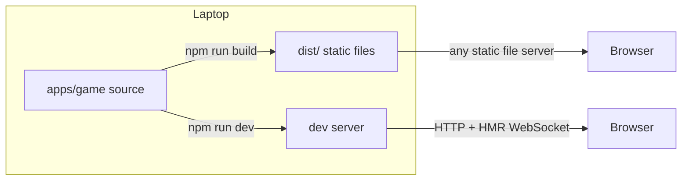
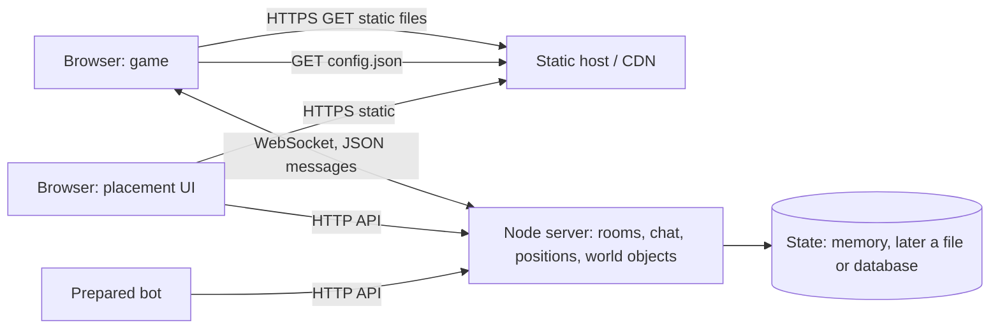
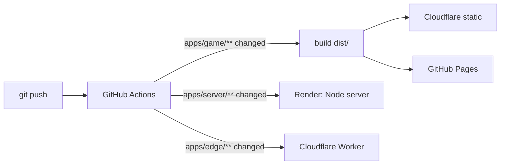

# System design

Authoritative for architecture, repository layout, delivery, interfaces and technology. Decision status lives in [decisions.md](decisions.md); IDs such as `D-07` refer to it.

**Implemented and verified on 2026-11-16:** the game baseline, that is §§ 3–5 where marked *verified* ([tasks.md § Phase 1](tasks.md#phase-1-game-baseline-g0)). Everything else is a proposal until [tasks.md](tasks.md) records it as run.

Sections marked **Initial** describe what exists before session 1. Sections marked **Tentative** describe extensions that a later session may introduce.

## 1. Architecture

### Initial: a static, client-only application



- All game code runs in the browser: rendering, input, physics, world loading.
- No server-side logic exists. A server only hands out files.
- The build output is a directory of static files that any HTTP server can serve unchanged ([D-08](decisions.md#d-08)).

This is deliberate: sessions 1–4 depend on the artifact being portable across serving arrangements.

### Tentative: with a backend



- The game learns the server address from runtime configuration (§ 5), so the same build works with or without a backend.
- Single-player must keep working when no backend is configured or reachable.

### Browser/server boundary

| Concern | Initial | With backend (tentative) |
| --- | --- | --- |
| Rendering, input, local physics | Browser | Browser |
| Static world layout | Browser, from a data file | Browser, from a data file |
| Other players, chat, placed objects | — | Server holds state; browser renders it |
| Validation, rate limits | — | Server |
| Persistence | — | Server |

## 2. Repository organization

One public GitHub repository using npm workspaces ([D-05](decisions.md#d-05), [D-06](decisions.md#d-06)).

### Initial layout

```
README.md
CLAUDE.md                AI entry point and rules
package.json             workspaces + root scripts
package-lock.json        pinned dependency versions
docs/                    planning documents (this directory)
apps/
  game/                  AI-owned game; README.md is its black-box contract
.github/workflows/       added with the first deployment (session 2 prep)
```

### Growth path

Add a directory only when a task needs it.

| Directory | Added for | Contents |
| --- | --- | --- |
| `infra/` | [S01](sessions/01-dev-server-and-build.md), [S04](sessions/04-delivery-paths.md) | Dockerfiles, static-server configs, host configuration |
| `packages/shared/` | [S05](sessions/05-first-backend.md) | Message and world-object schemas used by game, server and tools |
| `apps/server/` | [S05](sessions/05-first-backend.md) | Node + TypeScript backend |
| `apps/edge/` | [S04](sessions/04-delivery-paths.md) | Edge function in front of the static build |
| `apps/placer/` | [S07](sessions/07-live-world-editing.md) | Web UI for placing objects |
| `tools/` | [S08](sessions/08-abuse-and-validation.md) | Bots, reset scripts, rehearsal helpers |

### Three separate boundaries

| Boundary | Meaning here |
| --- | --- |
| Repository | One. Everything an AI needs for a cross-component change is in one checkout. |
| Application | One workspace per runnable thing (`apps/*`), plus shared contracts (`packages/*`). |
| Deployment | One GitHub Actions workflow per deployable, triggered by path filters. Each gets its own public URL. |

A single repository does not force a single deployment. A push that touches only `apps/server/**` deploys only the server.

### Why one repository

- Cross-component changes (protocol change touching game, server and placer) land in one commit and are verified together.
- AI finds instructions, contracts and code without cross-repo access.
- npm workspaces need no extra tooling. Add a task runner only if build times or task ordering become a real problem.

Split a component out only if it needs different access control or a host that requires its own repository. Neither is expected.

### AI-context strategy

- `CLAUDE.md` at the root routes to documents by task type.
- Each app has a `README.md` describing its commands, configuration, interfaces and verification. For the game this README is the complete human-facing contract.
- Shared contracts live in `packages/shared` as TypeScript types plus runtime schemas, imported by every component, so a contract change produces compile errors where it matters.
- Planning documents stay in `docs/` and are updated with the code.

## 3. Selected game technology

Chosen by AI as delegated ([D-07](decisions.md#d-07)). Internals are the implementing AI's concern.

| Part | Choice | Reason |
| --- | --- | --- |
| Language | TypeScript | Same language as the backend; shared contracts; Apache-2.0 |
| Rendering | Three.js | Most widely used browser 3D library; large body of examples for AI to draw on; MIT |
| Physics | Rapier (WebAssembly) with its character controller | Reliable collision, gravity, stairs and slopes; Apache-2.0 |
| Build tool | Vite | Fast dev server, standard static build, familiar to Node teams; MIT |
| Models/textures | Primitive geometry plus a few CC0 assets, all self-hosted | Zero cost, no third-party requests |
| Acceptance tests | Playwright against the built output | Verifies a black box without reading source; Apache-2.0 |

As built (2026-11-16): Three.js 0.187, Rapier 0.21 (`@dimforge/rapier3d`, loaded through `vite-plugin-wasm`, MIT), Vite 8.3, TypeScript 7.0, Playwright 1.65. Exact versions are pinned in `package-lock.json`. The only image assets are four small textures generated by a script in the game workspace; no third-party artwork is used.

Consequences for the surrounding system:

- The build is plain static files; no Node process is needed at runtime.
- The output contains several artifact types (HTML, hashed JS, CSS, a `.wasm` file, images or models). This is useful teaching material and should be preserved, not inlined away.
- `.wasm` should be served as `application/wasm`. Hosts and servers differ here, which sessions can observe.
- Asset URLs are relative, so the build works at a domain root and under a sub-path such as `user.github.io/repo/`.
- WebGL 2 is required. Target current Chrome, Safari and Firefox on macOS; Chrome is the rehearsal browser.
- Mouse look uses the Pointer Lock API, which needs a click to start.

## 4. Local runtime, build artifacts and delivery

### Root commands

Verified 2026-11-16 on macOS with Node 24. Flags, ports and extras: [apps/game/README.md § 1](../apps/game/README.md#1-commands).

| Command | Effect |
| --- | --- |
| `npm install` | Install all workspaces |
| `npm run dev` | Start the game dev server at `http://localhost:5173/` |
| `npm run build` | Produce the deployable build in `apps/game/dist/` |
| `npm run preview` | Serve the built output at `http://localhost:4173/` |
| `npm test` | Build, then run acceptance tests against the built output |

Differences from the proposal: `npm test` always rebuilds first, and it downloads Playwright's Chromium on first use. Both servers listen on `localhost` only unless `-- --host` is added.

### Expected build output

Verified 2026-11-16. Exact file list and sizes: [apps/game/README.md § 2](../apps/game/README.md#2-build-artifacts-and-runtime-requirements).

```
dist/
  index.html            entry; references hashed assets; must not be cached long
  assets/*.js|css       content-hashed filenames; safe to cache indefinitely
  assets/*.wasm         physics engine
  assets/*              images / models, content-hashed
  config.json           runtime configuration (not hashed)
  version.json          build identity (not hashed)
  world.json            static world layout (not hashed)
```

As built: three JavaScript files (game code, rendering library, physics glue), one CSS file, one 3 MB `.wasm` file and four PNG textures; about 4 MB in total. The game-code file changes with every build because it contains the build ID; the library files change only when the libraries do.

The split between hashed and unhashed files is the basis of [S03](sessions/03-caching-and-releases.md).

### Delivery arrangements

Proposed providers ([D-12](decisions.md#d-12)). None needs a custom domain ([D-15](decisions.md#d-15)).

| Arrangement | Provider | Used in | Card needed |
| --- | --- | --- | --- |
| Laptop exposed through a tunnel | Cloudflare Quick Tunnel | S02, fallback for servers | No, and no account |
| Managed static hosting on a CDN | Cloudflare (Workers static assets or Pages) | S02, S03, S04 | Not expected; confirm at sign-up |
| Second static host for contrast | GitHub Pages | S03, S04 | No |
| Container serving static files | Docker locally; Render free web service for a public URL | S01, S04 | Not confirmed; see [Q-03](decisions.md#q-03) |
| Edge function in the request path | Cloudflare Workers free plan | S04 | Not expected |
| Long-running Node server | Render free web service; laptop + tunnel as fallback | S05–S08 | Not confirmed |
| Stateful edge alternative | Cloudflare Durable Objects (free plan, SQLite backend) | Contrast in S06 or later | Not expected |

Free-tier figures and their sources are in [decisions.md § References](decisions.md#references).

## 5. Configuration, interfaces and data flows

### Runtime configuration

Decision: [D-09](decisions.md#d-09).

The game fetches `config.json` at startup. It is not baked into the bundle, so one build can be deployed to several hosts with different settings.

Initial shape (verified 2026-11-16):

```json
{
  "deploymentLabel": "local",
  "serverUrl": null
}
```

- `deploymentLabel` is shown in the diagnostics overlay so attendees can tell deployments apart.
- `serverUrl` is null until a backend exists. URL query parameters override values for demonstrations: `?deploymentLabel=`, `?serverUrl=`, and `?diag=1` to open the overlay.
- A missing or invalid `config.json` falls back to defaults rather than stopping the game.
- Later keys are added by the roadmap item that needs them.

### Build identity

`version.json` holds a build ID, the git commit, a flag for uncommitted changes, and the build time. The build ID is also compiled into the game code, and that compiled-in ID is what the game shows on screen. Sessions use it to see which version a browser is actually running, as opposed to the version the server currently has. Verified 2026-11-16.

### World data

Decision: [D-10](decisions.md#d-10).

The static world (terrain bounds, building, furniture, props) is described in `world.json` and loaded at runtime. Benefits:

- A visible change can be made without touching game code.
- "Changing content" and "deploying a new version" can be shown as different things in [S07](sessions/07-live-world-editing.md).
- The object schema later becomes the shared contract for placed objects.

As built (verified 2026-11-16): schema version 1 with named materials and four object types (`box`, `cylinder`, `tree`, `stairs`). Authoritative schema: [apps/game/README.md § 5](../apps/game/README.md#5-worldjson).

### Game operational surface

`apps/game/README.md` must document all of the following and nothing about internals:

1. Commands to run, build, preview and test.
2. Build artifacts and runtime requirements.
3. Every `config.json` key and query-parameter override.
4. The `world.json` schema.
5. Controls and the diagnostics overlay.
6. The test hook ([D-11](decisions.md#d-11)): a small object on `window` (as built: `window.__game`) exposing read-only state (player position, grounded flag, build ID, connection state) and test-only actions (teleport, simulated input), used by acceptance tests and rehearsals.
7. Later: the network protocol version it speaks.

### Tentative: backend interfaces

Decision: [D-13](decisions.md#d-13).

- Transport: one WebSocket per player, JSON messages, each with a `type` field. Schemas in `packages/shared`.
- HTTP API for the placement UI and bots: create, list and delete world objects.
- State in server memory first. Persistence is decided with [S07](sessions/07-live-world-editing.md) ([Q-05](decisions.md#q-05)).
- The server is a plain Node process with a Dockerfile, so it runs identically on a laptop, in a container and on a host.

Message types, rates and authority rules are specified when [S05](sessions/05-first-backend.md) and [S06](sessions/06-multiplayer-sync.md) are prepared.

## 6. Build and deployment

Proposed ([D-14](decisions.md#d-14)):

- GitHub Actions, one workflow per deployable, each with a `paths` filter.
- The game workflow builds once and uploads the same `dist/` to each static host, writing a per-host `config.json`.
- Deploy tokens are stored as GitHub Actions secrets.
- Every deployable keeps a manual deploy command for rehearsal and for recovery if Actions is unavailable.
- Every hosted demonstration has a local equivalent (Docker or a plain process) as its fallback.



## 7. Backend and infrastructure alternatives

| Need | Chosen (proposed) | Alternatives considered | Why not first |
| --- | --- | --- | --- |
| Static hosting | Cloudflare | Netlify, Vercel | Cloudflare exposes cache and edge headers clearly and offers edge functions and tunnels on one free account |
| Contrast host | GitHub Pages | — | Already available with the repository; no header control, which is the contrast |
| Public URL for a laptop | Cloudflare Quick Tunnel | ngrok | Quick Tunnel needs no account |
| Node hosting | Render free | Fly.io, Oracle Always Free VM, Railway | These need a payment card or have no standing free tier ([Q-03](decisions.md#q-03)) |
| Realtime transport | WebSocket via `ws` | Socket.IO, WebRTC | `ws` is the smallest thing that shows the mechanism |
| Sync framework to showcase | Open ([Q-04](decisions.md#q-04)) | Colyseus, Durable Objects/PartyServer, Yjs | Chosen when S06 is prepared |

Render's free service sleeps after 15 minutes without traffic and takes about a minute to wake. Rehearsal checklists must include waking it, and the cold start is itself a usable teaching point.
