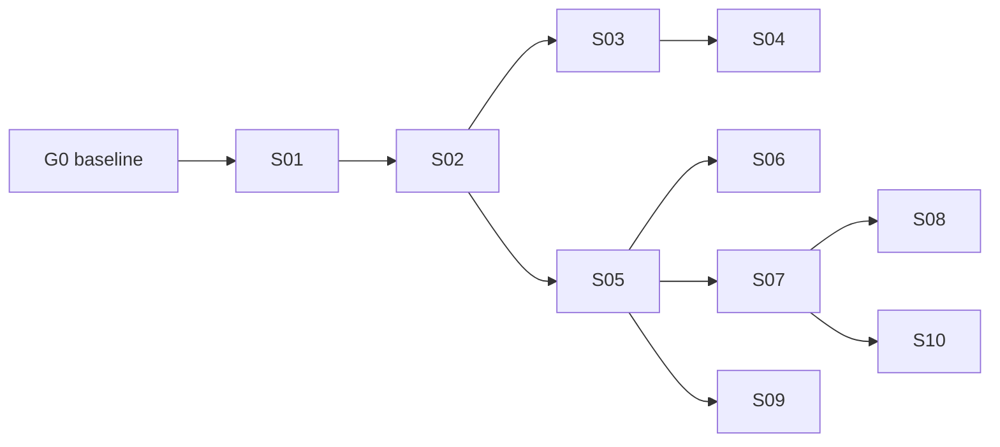

# Forum plan (primary roadmap)

The session lineup is **proposed** ([D-17](decisions.md#d-17)). Sessions 1–3 are planned in detail; sessions 4–10 are tentative and can be reordered, merged, dropped or replaced. Game work is tracked separately in [game-roadmap.md](game-roadmap.md).

## Learning objectives

By following the series, an attendee should be able to explain:

1. What a dev server does and what a build produces.
2. Which code runs in the browser and what needs a server.
3. How a browser gets from a URL to running code: DNS, TLS, HTTP, hosting.
4. How caching decides who sees a new version and when.
5. How serving arrangements differ in request path, operational responsibility and limits.
6. What changes when shared state and a backend are introduced.
7. Why data synchronisation is hard and what existing solutions take on.
8. How deploying a version differs from changing live content.
9. How to protect an open interface and how to see what a system is doing.

## Format

- 45 minutes, about monthly. First date is open ([Q-01](decisions.md#q-01)).
- Attendees follow in a browser with DevTools; running commands locally is optional ([D-03](decisions.md#d-03)).
- The organizer prepares everything beforehand with AI. Sessions explain, connect, demonstrate and let people try.

## Proposed sequence

Effort is the organizer's preparation with AI, including integration and rehearsal: **S** up to half a day, **M** one to two days, **L** three to five days, **XL** more.

| # | Session | Outcome type | Game changes | Prep effort | Status |
| --- | --- | --- | --- | --- | --- |
| [S01](sessions/01-dev-server-and-build.md) | The dev server and the build | Learning | None beyond [G0](game-roadmap.md#g0-playable-baseline) | S (after G0, which is L) | Detailed |
| [S02](sessions/02-localhost-to-public-url.md) | From localhost to a public URL | Learning, functionality | None | M | Detailed |
| [S03](sessions/03-caching-and-releases.md) | Caching and shipping a new version | Learning | None required; [G1](game-roadmap.md#g1-new-version-notice) optional | M | Detailed |
| [S04](sessions/04-delivery-paths.md) | Three ways to serve the same build | Learning, tool awareness | None | L | Tentative |
| [S05](sessions/05-first-backend.md) | The first backend: lobby and chat | Learning, functionality | [G2](game-roadmap.md#g2-lobby-and-chat) | L | Tentative |
| [S06](sessions/06-multiplayer-sync.md) | Multiplayer and data synchronisation | Learning, tool awareness | [G3](game-roadmap.md#g3-remote-players) | XL | Tentative |
| [S07](sessions/07-live-world-editing.md) | Changing a live world | Learning, functionality | [G4](game-roadmap.md#g4-live-world-objects) | L | Tentative |
| [S08](sessions/08-abuse-and-validation.md) | Spam, validation and rate limits | Learning, tool awareness | None beyond G4 | M | Tentative |
| [S09](sessions/09-observability.md) | Seeing what the system is doing | Learning, tool awareness | [G5](game-roadmap.md#g5-client-diagnostics-reporting) optional | M | Tentative |
| [S10](sessions/10-email-integration.md) | An automated email integration | Functionality, tool awareness | None | M, uncertain | Tentative, lowest priority |

## Dependencies

- S01–S04 need only the baseline game. If preparation time is short, the forum can run for four months without further game work.
- S04 can move later or be split in two without affecting anything else.
- S05 is the gate for everything involving shared state.
- S06 is the largest preparation item. S07 does not depend on it, so S07 and S08 can run first if time is short.

## Preparation and infrastructure by stage

| Stage | Infrastructure to prepare | Tasks |
| --- | --- | --- |
| Before S01 | Repository, game baseline, local static-server examples | [Phases 0–2](tasks.md) |
| Before S02 | Cloudflare account, static deployment, deploy workflow, tunnel rehearsal | [Phase 3](tasks.md#phase-3-session-2-preparation) |
| Before S03 | Header configuration, second host, release and rollback rehearsal | [Phase 4](tasks.md#phase-4-session-3-preparation) |
| Before S04 | Container image, public container host, edge function | [Later work](tasks.md#later-work-tentative) |
| Before S05 | `apps/server`, `packages/shared`, Node hosting, G2 | Later work |
| Before S06–S10 | See each session file | Later work |

## Recurring session practice

Each session file states its starting state, reset steps, rehearsal checklist and fallback. Common rules:

- Rehearse on the forum's actual network the day before ([Q-07](decisions.md#q-07)).
- Wake any sleeping free-tier service 10 minutes before the session.
- Keep a local equivalent of every hosted demonstration.
- Keep screenshots or a recorded capture of each key observation.
- Tag the repository state used for each session (`session-01`, …) so it can be reproduced later.

## Candidate backlog

Not scheduled. Promote when there is interest.

- Preview deployments per pull request.
- Load testing the server with scripted players.
- Porting the room server to Durable Objects and comparing operating models.
- Persistence choices: file, SQLite, managed database.
- Points, quests or other gameplay systems (undecided).
